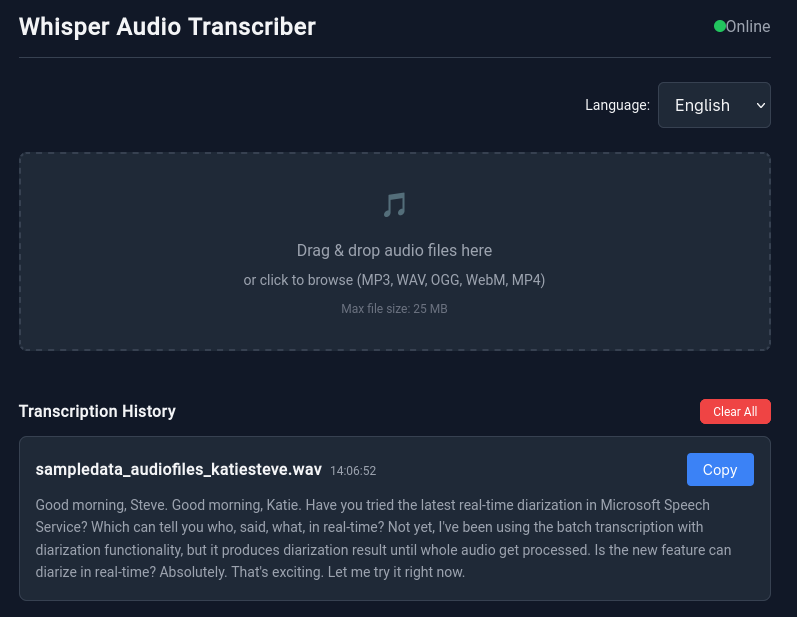

# Whisper Transcriber

A web application for converting audio files to text using local Whisper backend. Built with React 19, TypeScript. Containerized deployment using Podman.




## Features

- 🎤 **Multi-Language Support**: Transcribe audio in 99+ languages (default: English, Spanish, Italian)
- 📁 **Sequential Processing**: Upload and process multiple files one by one
- ⚡ **Real-Time Status**: Progress tracking with visual feedback
- 🏥 **Health Monitoring**: Automatic backend health checks with green/red indicator
- 🌓 **Dark Theme**: Built-in dark mode styling
- 📤 **Multiple Formats**: Supports WebM, WAV, MP4, MP3, OGG, M4A, FLAC (max 25MB)

## Quick Start

### Prerequisites

- Node.js 18+
- Podman 4.0+
- Whisper backend (https://hub.docker.com/r/hwdsl2/whisper-server)

### Sample Audio File

```bash
# Download sample audio file for testing
curl -L -o sample_speech.wav \
    "https://github.com/Azure-Samples/cognitive-services-speech-sdk/raw/master/sampledata/audiofiles/katiesteve.wav"
```

## Development

### Option 1: Makefile 

```bash
# Start development mode (backend container + frontend dev server)
make dev

# Access frontend at http://localhost:3000
# Backend health at http://localhost:8005/health

# Stop development mode
make dev-stop
```

### Option 2: Manual Setup

```bash
# Start Whisper backend container
podman run -d \
  --name whisper-server-dev \
  -p 8005:9000 \
  -e WHISPER_MODEL=tiny.en \
  -e WHISPER_API_KEY= \
  docker.io/hwdsl2/whisper-server

# Wait 30 seconds for model to download and initialize
sleep 30

# Start frontend development server
npm run dev

# Access at http://localhost:3000

# Stop when done
podman stop whisper-server-dev
podman rm whisper-server-dev
```

## Building for Production

### Using Makefile

Start both frontend and backend in a single pod:

```bash
# Using podman play
make prod

# Or manually
podman play kube etc/podman-play.yaml

# Access at http://localhost:8080
```

**Stop production mode:**
```bash
make prod-stop
```

### Manual Build and Deploy

```bash
# Build production image using podmanfile
podman build -t whisper2:latest -f podmanfile .

# Deploy using podman play kube (creates pod with both containers)
podman play kube etc/podman-play.yaml

# Access frontend at http://localhost:8080

# Stop containers
podman stop whisper-ux whisper-server
podman rm whisper-ux whisper-server
```

## Container Deployment

### Development Mode

```bash
# Start backend container
podman run -d \
  --name whisper-server-dev \
  -p 8005:9000 \
  -e WHISPER_MODEL=tiny.en \
  -e WHISPER_API_KEY= \
  docker.io/hwdsl2/whisper-server

# Wait for model to load (~30 seconds)
sleep 30

# Start frontend locally
npm run dev

# Access at http://localhost:3000

# Stop when done
podman stop whisper-server-dev
podman rm whisper-server-dev
```

### Production Mode (Podman Pod)

```bash
# Build production image
podman build -t whisper2:latest -f podmanfile .

# Deploy using podman play kube
podman play kube etc/podman-play.yaml

# Access frontend at http://localhost:8080
# Backend API at http://localhost:8005

# Stop all containers
podman stop whisper-pod-whisper-ux whisper-pod-whisper-server
podman rm whisper-pod-whisper-ux whisper-pod-whisper-server
```

### Production Mode (Podman Compose)

```bash
# Start all containers
podman-compose -f etc/podman-compose.yml up -d

# Or from another directory
cd etc
podman-compose up -d

# Stop all containers
podman-compose -f etc/podman-compose.yml down

# Access frontend at http://localhost:8080
```

## API Testing

### Health Check

```bash
curl http://localhost:8005/health
```

### Transcription

```bash
curl -X POST http://localhost:8005/v1/audio/transcriptions \
  -F "file=@sample_speech.wav" \
  -F "language=en" \
  -F "model=tiny.en"
```

### Example Response

```json
{
  "text": "Good morning, Steve. Good morning, Katie. Have you tried the latest real-time diarization in Microsoft Speech Service?"
}
```

## Configuration

### Environment Variables

| Variable | Description | Default |
|----------|-------------|---------|
| `WHISPER_API_URL` | Backend API URL for production (frontend uses relative `/v1/audio` in dev) | `http://localhost:8005` |
| `VITE_WHISPER_API_URL` | Frontend API URL (dev, relative) | `/v1/audio` |
| `HEALTH_CHECK_INTERVAL` | Health check interval in milliseconds | `20000` |
| `WHISPER_MODEL` | Whisper model to use | `tiny.en` |
| `VITE_APP_ENV` | Environment mode | `development` |

**Note:** The `WHISPER_API_URL` parameter is used in production mode when the frontend is containerized. In development mode, the frontend uses relative paths (`/v1/audio`) which are proxied by Vite to the backend running on port 8005.

### Supported Languages

The application supports 99+ languages. Default languages are:
- English (`en`)
- Spanish (`es`)
- Italian (`it`)

To use other languages, specify the language code when uploading or in the API call.

## Supported Audio Formats

| Format | Extension | Max Size |
|--------|-----------|----------|
| WebM | `.webm` | 25 MB |
| WAV | `.wav` | 25 MB |
| MP4 | `.mp4` | 25 MB |
| MP3 | `.mp3` | 25 MB |
| OGG | `.ogg` | 25 MB |
| M4A | `.m4a` | 25 MB |
| FLAC | `.flac` | 25 MB |

## Project Structure

```
whisper2/
├── src/
│   ├── components/          # React UI components
│   │   ├── UploadArea/     # Drag & drop file upload
│   │   ├── FileQueue/      # Queue display with progress
│   │   ├── HistoryTable/   # Transcription history
│   │   └── HealthIndicator/# Health status indicator
│   ├── services/           # API client services
│   │   └── whisperApi.ts   # API client with health checks
│   ├── types/              # TypeScript type definitions
│   └── App.tsx             # Main application component
├── etc/
│   ├── nginx/                 # Nginx configuration files
│   ├── podman-compose.yml     # Podman compose configuration
│   └── podman-play.yaml       # Podman play kube manifest
├── build/                  # Production build output
├── nginx.conf              # Nginx reverse proxy config
├── podmanfile              # Podman build definition
├── Makefile                # Container management commands
├── package.json            # Frontend dependencies
└── README.md               # This file
```

## Development Workflow

1. **Start Backend**: Run `podman run -d --name whisper-server-dev -p 8005:9000 docker.io/hwdsl2/whisper-server`
2. **Wait for Model**: Wait 30 seconds for model to download from HuggingFace
3. **Start Frontend**: Run `npm run dev`
4. **Access App**: Open http://localhost:3000
5. **Upload File**: Drag & drop or select audio file
6. **View Results**: Transcription appears in history table

## Makefile Commands

| Command | Description |
|---------|-------------|
| `make help` | Show available commands |
| `make dev` | Start development mode (backend container + frontend) |
| `make dev-stop` | Stop development mode |
| `make prod` | Start production mode (podman pod) |
| `make prod-stop` | Stop production mode |
| `make prod-restart` | Restart production mode |
| `make logs` | View container logs |
| `make clean` | Clean build artifacts and containers |

## Troubleshooting

### Backend Won't Start

```bash
# Check if container is running
podman ps | grep whisper-server

# View container logs
podman logs whisper-server-dev

# Restart container
podman restart whisper-server-dev
```

### Model Download Issues

The model is downloaded from HuggingFace on first start. If download fails:
- Check internet connection
- Set `HF_TOKEN` environment variable for higher rate limits
- Try different model: `-e WHISPER_MODEL=base.en`

### Port Already in Use

```bash
# Find process using port 8005
ss -tlnp | grep 8005

# Stop the process or use different port
podman run -d -p 8006:9000 --name whisper-server-dev docker.io/hwdsl2/whisper-server
```

### Frontend Build Errors

```bash
# Clear cache and reinstall
rm -rf node_modules package-lock.json
npm install

# Clean build
rm -rf build
npm run build
```

### CORS Errors

Ensure the backend is running and accessible. In development, Vite proxy handles CORS automatically.

### Health Indicator Not Green

Check backend health:
```bash
curl http://localhost:8005/health
```

If unhealthy, wait for model download or check backend logs:
```bash
podman logs whisper-server-dev
```

## Integrations

Self-hosted Whisper transcription API. OpenAI-compatible, powered by faster-whisper:
https://hub.docker.com/r/hwdsl2/whisper-server

Whisper speech-to-text  
https://github.com/hwdsl2/whisper-install

## License

MIT License.

## Container Image Management

### Backup and Restore Example

For a complete backup and restore workflow:

```bash
# Export current image with timestamp
podman save -o whisper-backup-$(date +%Y%m%d).tar whisper-ux

# Restore image later
podman load -i whisper-backup-20260115.tar
```
